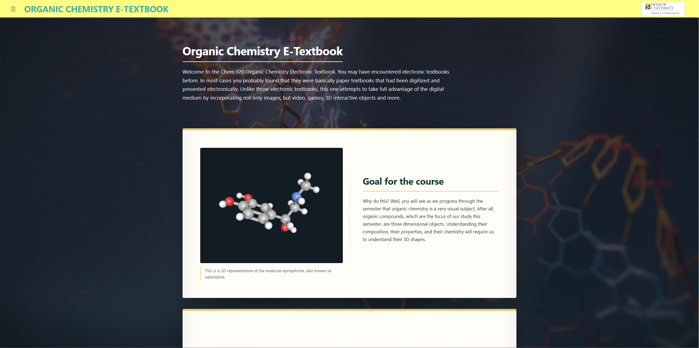
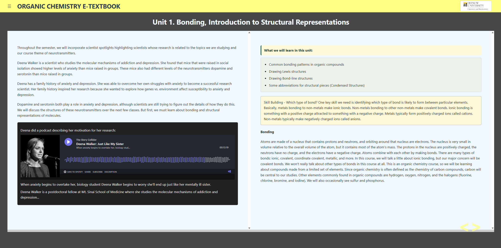
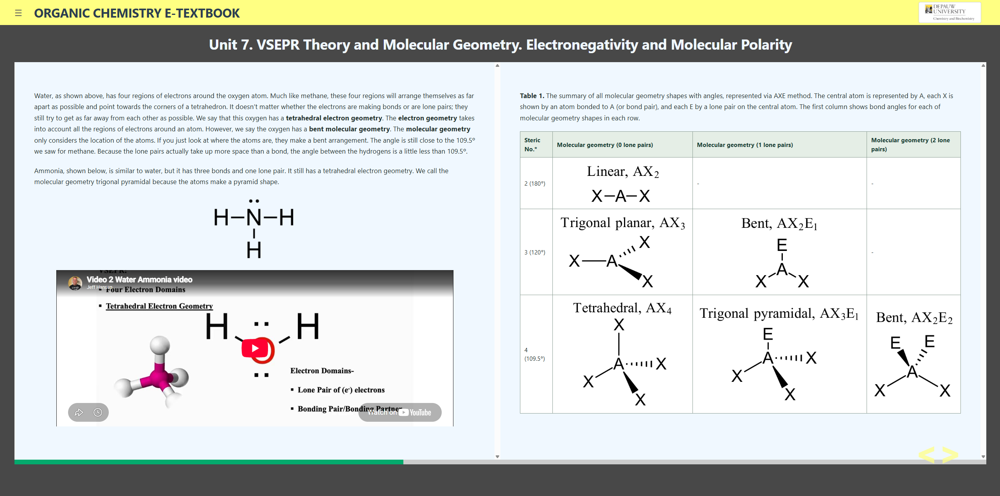

# CHEM 120 Organic Chemistry E-Textbook

An web-based organic chemistry textbook for DePauw University's CHEM 120 course.







## Motivation

Organic chemistry is a very visual subject. After all, organic compounds, which are the focus of our study this semester, are three dimensional objects. Understanding their composition, their properties, and their chemistry will require us to understand their 3D shapes. However, we often need to represent organic compounds on 2D surfaces - a piece of paper, a computer screen, or a whiteboard. One of our challenges will be to learn how to represent these molecules in 2D while having a 3D understanding of them. This e-textbook attempts to bridge the gap between 2D pictures and 3D understanding.

## Setup

```sh
npm install
npm run serve
```

Use the local URL printed in the terminal. To validate the lesson content and create a production build:

```sh
npm run validate:content
npm run build
```

## Updating content

See [UPDATE_GUIDE.md](UPDATE_GUIDE.md) for the content workflow, JSON DSL schema, media paths, validation, and publishing steps.
